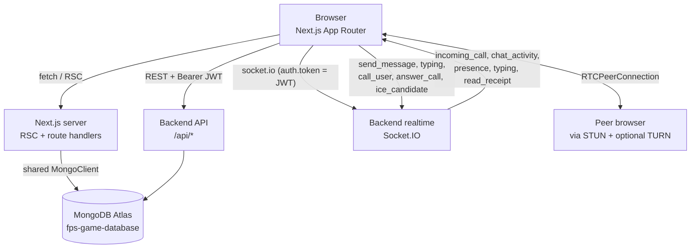

# 🎮 FPS Game Database — Web

**A Next.js catalog, leaderboard and realtime social dashboard for competitive FPS games.**

A server-rendered reference catalog (weapons, characters, maps, modes, throwables, equipment), a live leaderboard, and a realtime dashboard with DMs, group chats, voice and video calls, friends, presence and progression. Built on Next.js 16 (App Router), MongoDB for the catalog, Socket.IO for realtime, and WebRTC for peer-to-peer calls.

[](https://fps-game-database-web.vercel.app)
[](https://YOUR_VIDEO_URL)
[](./LICENSE)

[](https://nextjs.org)
[](https://www.typescriptlang.org)
[](https://mongodb.com)
[](https://socket.io)
[](https://webrtc.org)
[](https://tailwindcss.com)
[](https://github.com/shaurya-10000/fps-game-database-web/actions/workflows/ci.yml)


[**Live demo**](https://fps-game-database-web.vercel.app) · [**Walkthrough**](https://YOUR_VIDEO_URL) · [**Backend repo**](https://github.com/shaurya-10000/fps-game-database) · [**Architecture**](#architecture) · [**Quick start**](#quick-start)

> **Two repos, one product.** This repo is the web frontend. The backend ([`fps-game-database`](https://github.com/shaurya-10000/fps-game-database)) owns the REST API, Socket.IO server, match recording, ratings and the social graph. This app consumes it and additionally reads the catalog straight from MongoDB.

---

## Contents

- [Highlights](#highlights)
- [Features](#features)
- [Architecture](#architecture)
- [Frontend API surface](#frontend-api-surface)
- [Core guarantees](#core-guarantees)
- [Design decisions](#design-decisions)
- [Feature deep dives](#feature-deep-dives)
- [Tech stack](#tech-stack)
- [Quick start](#quick-start)
- [Environment variables](#environment-variables)
- [Scripts](#scripts)
- [Project structure](#project-structure)
- [Testing](#testing)
- [Deployment](#deployment)
- [Troubleshooting](#troubleshooting)
- [Known limitations](#known-limitations)
- [Roadmap](#roadmap)
- [License](#license)

---

## Highlights

- **Server-rendered first.** The catalog and public leaderboard are React Server Components reading MongoDB through `"use cache"` getters with `cacheLife("hours")` and per-entity cache tags. A content update is one Mongo write plus one `POST /api/revalidate?tag=catalog:v1:weapons`.
- **The dashboard is a client island.** DMs, group chats, presence, typing, read receipts, reactions, pins and calls all ride a single Socket.IO connection opened by the dashboard layout. Navigating between dashboard pages never reconnects, and an incoming call rings on every dashboard route.
- **Calls outlive navigation.** A `WebRTCManager` mounted above the dashboard routes owns the `RTCPeerConnection`. It can minimize, go picture-in-picture, change devices, share a screen and be resumed from anywhere in the dashboard.
- **Typed and validated at every boundary.** Strict TypeScript, Zod-shaped catalog documents on the server, and a shared `leaderboard-shared.ts` (rules, not just types) used by both the ranking page and the tier badge.
- **Personalization without migrations.** Favorites, pinned/muted/archived chats, per-room themes, per-room clear, font size, sounds and snooze are browser-local, versioned, and fail closed.
- **Accessible by default.** Every control has a name, every overlay has `role="dialog"`, focus is trapped and returned, and motion respects `prefers-reduced-motion`.
- **Aligned with the backend's guarantees.** Exact-once match recording, sequence-ordered Elo and the idempotent social graph are surfaced on the pages users actually see.

## Features

| Area | What it does |
| :--- | :--- |
| **Home** | Hero with dynamic auth CTAs, character carousel, mode grid, weapons marquee, map carousel, throwables, equipment showcase, live leaderboard |
| **Catalog (SSR)** | Weapons, characters, maps, modes, throwables, equipment with search, filters and a detail modal. Full ballistics for weapons, roles for characters, cover and modes for maps |
| **Rankings** | Podium for the top 3, table for the rest, seven tiers with divisions, cursor pagination, global / friends / region tabs |
| **Auth** | JWT in `localStorage`, decoded client-side, bearer-authenticated REST and socket. Dashboard routes gated by `AuthGate` |
| **Profile and progression** | Level ring, XP bar, tier badge, rank, career stats, K/D, win rate, ranked record, rating history chart, recent matches with rating deltas, edit dialog |
| **Friends** | Debounced search, incoming and outgoing requests, favorites, mutes, blocks, per-row call / DM / menu |
| **DMs and groups** | Pinned, groups, recent, friends and archived lists. Create, rename (admin), add and remove members, leave, system notices |
| **Messages** | Reply, 8 reactions, edit, delete for all, pin (50 per room), star, forward, voice notes, server-side search, links, jump, retry, discard |
| **Global chat** | Room-scoped, mute list, block list, per-room theme, per-room clear, per-room turn-off |
| **Calls** | Voice and video, screen share, mute, camera swap, device menu (`setSinkId`), minimize, PiP, live quality pill, ring timeout, `missed` and `no-answer` paths |
| **Notifications** | Desktop notifications for messages and incoming calls, permission prompt, per-type mute, snooze |
| **Presence** | `presence_snapshot` and `presence` events drive online dots across friends, chat and calls |
| **Themes** | Light / dark, plus 10 chat themes (gradient, wallpaper, accent) with live preview |

---

## Architecture

One Next.js app, two halves: a cached marketing catalog and a live dashboard. They share a design system, a Mongo client, and a set of typed catalog and leaderboard modules.



| Half | Routes | Rendering |
| :--- | :--- | :--- |
| **Marketing** | `/`, `/weapons`, `/characters`, `/maps`, `/modes`, `/throwables`, `/equipment`, `/rankings` | RSC, cached with tags |
| **Dashboard** | `/dashboard`, `/dashboard/dms`, `/dashboard/friends`, `/dashboard/chat` | Client island, live |

### Design principles

1. **The catalog is data, not markup.** Adding a weapon, map or mode is one MongoDB document. No new page, component or route.
2. **RSC for the catalog, client for the dashboard.** The catalog and leaderboard are server-rendered and cached for hours; the dashboard owns the socket, the call manager and per-browser preferences.
3. **The `WebRTCManager` is the only peer object.** It lives above the router, is disposed on sign-out, and the UI renders from its state rather than the other way around.
4. **The catalog serves one contract.** Every page reads from `lib/catalog.ts`. A tier change happens in `leaderboard-shared.ts` and reaches every surface at once.
5. **Prefer a browser-local preference over a schema change.** Local storage with a versioned key.
6. **Fail closed on auth and calls.** `AuthGate` sends a user with no valid JWT to the login page before rendering dashboard chrome; `useCall` only starts a manager with a valid token.
7. **Let the browser be the source of truth for capabilities.** Device lists, speaker routing, PiP and audio unlock are detected at runtime.

### Failure model

| Failure | Behavior |
| :--- | :--- |
| Backend unreachable on a catalog page | Next.js error boundary; recovers on reload once the backend is back |
| Backend unreachable on a dashboard page | `useProfile` shows a banner with Retry; other cards still render |
| JWT expires while the dashboard is open | Socket disconnects, `useProfile` retries fail with `401`, `AuthGate` routes to `/dashboard/login` |
| Duplicate submission of a chat message | Backend dedupes; the frontend replaces the optimistic copy on echo |
| Socket drops mid-chat | "Reconnecting…" banner, composer disabled, automatic reconnect |
| Call ring timeout (60 s caller / 75 s callee) | Ringtone stops, an "ended" card shows the reason, state resets to `idle` after ~2.5 s |
| Tab closed during a call | `WebRTCManager.dispose()` stops all tracks; the backend `call_ended` reaches the peer |
| Camera denied, mic granted | Falls back to audio-only with a notice |
| Browser blocks the ringtone | `SoundBanner` offers a one-click unlock; the call still rings visually |
| PiP or speaker selection unsupported | PiP button hidden; speaker select disabled with a hint |
| Ring timeout with another tab open | Only the tab that owns the manager fires `end_call` |

---

## Frontend API surface

The frontend talks to the backend over a REST API (bearer JWT) and a Socket.IO connection (same JWT in `auth.token`). The authoritative contract lives in the [backend repo](https://github.com/shaurya-10000/fps-game-database); this is what the frontend actually uses.

<details>
<summary><strong>REST endpoints</strong></summary>

| Method | Path | Purpose |
| :--- | :--- | :--- |
| `POST` | `/api/auth/login` | Email and password → `{ token, player }` |
| `POST` | `/api/auth/register` | Email, username, password → `{ token, player }` |
| `GET` / `PATCH` | `/api/me/profile` | Read, or update `{ displayName?, username?, email? }` |
| `GET` | `/api/me/progression` | `{ level, currentLevelXp, xpForNextLevel, progressPercent }` |
| `GET` | `/api/me/overview` | `{ rating, tier, rank, ratedPlayers, career, ratingHistory, recentMatches, memberSince }` |
| `GET` | `/api/me/friends` | Accepted friendships |
| `GET` | `/api/me/friends/requests` | Incoming requests |
| `GET` | `/api/me/friends/requests/outgoing` | Outgoing requests |
| `POST` | `/api/me/friends/requests` | Send a request: `{ toPlayerId }` |
| `POST` | `/api/me/friends/requests/:fromPlayerId/accept` | Accept |
| `DELETE` | `/api/me/friends/requests/:otherId` | Cancel or decline |
| `DELETE` | `/api/me/friends/:otherId` | Unfriend |
| `GET` | `/api/me/players/search?q=` | Player search |
| `GET` / `POST` / `DELETE` | `/api/me/blocks[/:playerId]` | List, block, unblock |
| `GET` / `POST` / `DELETE` | `/api/me/mutes[/:playerId]` | List, mute, unmute |
| `GET` | `/api/chat/dm-by-id/:playerId` | Get or create the DM room |
| `GET` / `POST` | `/api/chat/groups` | List or create groups |
| `PATCH` | `/api/chat/groups/:roomId` | Rename (admin) |
| `POST` | `/api/chat/groups/:roomId/members` | Add friends |
| `DELETE` | `/api/chat/groups/:roomId/members/:playerId` | Remove a member or leave |
| `GET` | `/api/chat/rooms/:roomId/history?before=&limit=` | Paged history |
| `GET` | `/api/chat/rooms/:roomId/search?q=` | Search |
| `GET` | `/api/chat/rooms/:roomId/pins` | Pinned messages |
| `POST` / `DELETE` | `/api/chat/rooms/:roomId/messages/:messageId/pin` | Pin or unpin |
| `PATCH` / `DELETE` | `/api/chat/rooms/:roomId/messages/:messageId` | Edit own text, or delete for all |
| `POST` | `/api/chat/rooms/:roomId/messages/:messageId/reactions` | Toggle a reaction |
| `POST` | `/api/chat/rooms/:roomId/voice` | Upload a voice note |
| `GET` | `/api/chat/rooms/:roomId/reads` | Read receipts |
| `GET` | `/api/chat/unread` | Unread counts |
| `POST` | `/api/chat/calls` | Save a finished call into a DM |
| `GET` | `/api/leaderboards/global` | Global rankings |
| `GET` | `/api/leaderboards/friends` | Friends rankings |
| `GET` | `/api/leaderboards/region/:region` | Regional rankings (`NA`, `EU`, `APAC`, `SA`) |
| `GET` | `/api/leaderboards` | Cursor-paginated rankings (called directly by the server component) |

</details>

<details>
<summary><strong>Socket events</strong></summary>

| Direction | Event | Payload |
| :--- | :--- | :--- |
| C→S | `join_room` | `roomId` |
| C→S | `send_message` | `{ roomId, content, replyToId? }` |
| C→S | `typing` | `{ roomId, typing }` |
| C→S | `mark_read` | `{ roomId }` |
| C→S | `call_user` | `{ targetPlayerId, offer, isVideo }` |
| C→S | `answer_call` | `{ targetPlayerId, answer }` |
| C→S | `ice_candidate` | `{ targetPlayerId, candidate }` |
| C→S | `end_call` | `{ targetPlayerId }` |
| S→C | `room_history` | Latest 50 messages |
| S→C | `new_message` | Message, including system notices |
| S→C | `message_edited`, `message_deleted`, `message_reactions`, `message_pinned`, `message_unpinned` | Message-level events |
| S→C | `typing` | `{ roomId, playerId, name, typing }` |
| S→C | `read_receipt` | `{ roomId, playerId, at }` |
| S→C | `chat_activity` | `{ roomId, kind, senderId, senderName, preview, messageId, createdAt }` |
| S→C | `presence_snapshot`, `presence` | Presence updates |
| S→C | `group_updated` | `{ roomId }` |
| S→C | `incoming_call`, `call_answered`, `ice_candidate`, `call_ended` | Call lifecycle |

</details>

---

## Core guarantees

| Guarantee | Mechanism |
| :--- | :--- |
| A user can't see another user's DMs | The backend scopes each room to its participants; the client also refuses to join a room the user isn't in |
| A user can't be in two calls | `WebRTCManager.isBusy()` short-circuits `startCall` and answers a second `incoming_call` with `end_call` |
| Incoming calls ring on every dashboard route | `incoming_call` is handled by the layout-mounted provider, not by a page |
| A hung call ends | `call_user` and `answer_call` both arm a `RING_TIMEOUT_MS` timer; `no-answer` and `missed` both clear the UI |
| Media stops when the call ends | `teardown()` stops every local and screen track, closes the peer connection and data channel, and bumps a `session` counter so in-flight async work becomes a no-op |
| A refreshed tab can't strand a `MediaStream` | `CallProvider` disposes the manager on sign-out; `dispose()` stops all tracks |
| Chat can't be sent from the wrong identity | The socket's `auth.token` is the JWT; the UI can't spoof a `senderId` |
| Optimistic messages can't get stuck | `SEND_TIMEOUT_MS` marks a message `failed` if the echo never arrives; `retry` re-emits, `discard` removes it |
| Old rooms can't render in the wrong conversation | `useRoomMessages` clears state on `roomId` change and every handler filters by `e.roomId === roomId` |
| Private preferences stay local | `useChatPrefs` reads `localStorage` on mount; cross-tab `storage` events are ignored by socket-based hooks |
| The tier a player sees matches the server | `lib/leaderboard-shared.ts` is the single source of tier rules; the client never derives a different tier |
| Cache invalidation is surgical | `getWeapons` tags `catalog:v1:weapons`; revalidating that tag refreshes only that collection |
| Sound can't surprise the user | Ringing is gated by a `SoundBanner` unlock prompt when audio is blocked; `useCallFeedback` stops the ringtone on end |

## Design decisions

| Decision | Why | Trade-off |
| :--- | :--- | :--- |
| **`"use cache"` per entity, not per page** | One tag invalidates exactly the collection that changed | First visit after a deploy is slower while the cache warms |
| **One `WebRTCManager` for the whole dashboard** | A call outlives navigation; ringing UI is available everywhere | A class sits slightly outside React's model; state flows in via `setState` callbacks |
| **Optimistic chat, server echo as authority** | Sending feels instant; the echo makes ordering and ids canonical | A message can briefly show twice; the pending map dedupes by `content` |
| **Per-browser chat preferences** | Zero migration cost; users tune once | Preferences don't follow the user to a new browser |
| **`leaderboard-shared.ts` shares rules, not only types** | Client and server both need the tier *rules* | A tier change touches two repos if the backend is separate |
| **Server-render the catalog, client-render the dashboard** | Catalog is read-mostly and cacheable; dashboard is write-heavy and per-user | Two mental models in one app |
| **Static ICE, TURN optional** | Google STUN is enough to demo; TURN is one env var away | Peers behind symmetric NATs can't connect without TURN |
| **Synthesized sounds, not audio files** | Nothing to host, sub-frame latency | The sound set is deliberately small |
| **Sensible `DEFAULT_CHAT_SETTINGS`** | A fresh user has a usable chat on first load | Changing anything means finding the settings menu |

---

## Feature deep dives

<details>
<summary><strong>🎯 The catalog and caching</strong></summary>


Every collection is read through `lib/catalog.ts`. Each getter is a server function with a cache directive and tags:

```ts
export async function getWeapons(version = "v1"): Promise<Weapon[]> {
  "use cache";
  const { cacheLife, cacheTag } = await import("next/cache");
  cacheLife("hours");
  cacheTag("catalog", `catalog:${version}`, `catalog:${version}:weapons`);
  const doc = await getCatalogDoc(version);
  return doc?.weapons ?? [];
}
```

The catalog is one `contentVersions` document per version (`_id: "v1"`) with an array per collection, so "publish the new patch" is a single atomic write. Invalidating one collection is `POST /api/revalidate?tag=catalog:v1:weapons`.

| Collection | Key fields |
| :--- | :--- |
| `weapons` | `id`, `name`, `type`, `price`, `stats` (damage, fire rate, magazine, reload, headshot multiplier, range, falloff start/end, minimum damage, vertical and horizontal recoil, spread, penetration, `isAutomatic`) |
| `characters` | `id`, `name`, `role`, `difficulty`, `abilities[]`, `description` |
| `maps` | `id`, `name`, `description`, `gameModes[]`, `size`, `hasCover` |
| `gameModes` | `id`, `name`, `description`, `buckets[]`, `teamSize`, `roundsPerMatch`, `battleRoyaleTeamSizes?` |
| `throwables` | `id`, `name`, `type`, `damage`, `radiusMeters`, `durationMs`, `price`, `description` |
| `equipment` | `id`, `name`, `category`, `level?`, `ammoFor?`, `effect`, `price` |

Every catalog page follows the same shape: a server `page.tsx` calls one getter and renders an `<X>Grid` client component with a search box, category filters, animated `AnimatePresence` cards and a `<DetailModal>`. There is no per-item route; the modal is the detail view.

</details>

<details>
<summary><strong>🏆 The leaderboard</strong></summary>


`getLeaderboardUncached(limit, cursor, filters)` is a keyset-paginated read over `competitiveRatings`:

- **Sort:** `{ rating: -1, _id: 1 }`, so ties are stable.
- **Cursor:** base64 of `{ rating, playerId }`; the query becomes `rating < cursor.rating OR (rating = cursor.rating AND _id > cursor.playerId)`.
- **Rank:** the first row's rank is the count of rows strictly above it, so `rankOffset + i` is the true rank mid-table.
- **Names:** hydrated from `players` in a single `$in` query.

`getLeaderboard` wraps the uncached variant with `"use cache"`, `cacheLife("minutes")` and `cacheTag("leaderboard")`, so the public page is fresh while route handlers can still call the uncached variant.

**Tiers** come from one table in `leaderboard-shared.ts`, imported by server and client:

| Tier | Rating |
| :--- | :--- |
| Bronze | 0 – 1200 |
| Silver | 1200 – 1500 |
| Gold | 1500 – 1800 |
| Platinum | 1800 – 2100 |
| Diamond | 2100 – 2400 |
| Master | 2400 – 2800 |
| Legendary | 2800+ |

Within a tier, `division = 3 - floor((rating - minRating) / 100)`, clamped to `[1, 3]`. Legendary is division-less and always reports `1`.

`RankingsTable` starts with server-rendered entries, then switches between **Global**, **Friends** and **Region** (`NA | EU | APAC | SA`) tabs. The top three render as a podium; the rest as a table with per-tier badge colors, animated with Framer Motion.

**Seeding.** `scripts/seed-leaderboard.mjs` upserts 50 deterministic fake players into `competitiveRatings` and `players`, so the leaderboard is populated right after `npm run dev`.

</details>

<details>
<summary><strong>💬 Realtime chat</strong></summary>


One Socket.IO connection, opened by the dashboard layout, carries all DM and group traffic. `useRoomMessages` is the single source of truth for one room.

- **History.** Opening a room emits `join_room` and receives `room_history`. The socket stays open across rooms; every handler filters by `roomId`.
- **Optimistic send.** A pending entry appears immediately; `SEND_TIMEOUT_MS` marks it `failed` if no echo arrives. `retry` re-emits the same `content` (already deduped server-side); `discard` removes it.
- **Replies, reactions, pins, edits, deletes.** Each is a backend endpoint plus a socket event. Reactions and pins are optimistic; edits and deletes are server-authoritative.
- **Reply preview.** `replyTo` captures `{ messageId, senderId, senderName, preview }` at reply time, so later edits or deletes can't corrupt it.
- **Read receipts.** `useReadReceipts` emits `mark_read` while the room is open and visible, loads initial state from `GET /reads`, and listens for `read_receipt`.
- **Unread counts.** `useUnread` listens to `chat_activity` for closed chats and clears on `join_room` and `visibilitychange`. The count is mirrored into `document.title`, e.g. `(3) FPS Database`.
- **Typing.** `useTyping` throttles to one event per 2.5 s, sends `typing: false` on idle, and expires a name after 6 s.
- **Drafts.** The last value typed in a room is restored the next time it opens.

`buildRows` in `group-messages.ts` merges `messages`, `pending`, `events` and `system` notices into one sorted list, emits day separators, and computes `first` / `last` / `showSender` from a 5-minute gap to draw bubble tails.

</details>

<details>
<summary><strong>📞 Voice and video calls</strong></summary>


The whole call surface is one `WebRTCManager`, constructed in `CallProvider` (inside `DashboardCallLayer`), so it lives across every dashboard route.

```text
idle ──startCall──► calling ──answer──► connecting ──ice──► active ──endCall──► ended ──timer──► idle
                                                                          
idle ◄─ ringing ◄──incoming_call── (callee side; acceptCall → connecting)

calling ──ring timeout──► ended (no-answer)
ringing ──ring timeout──► ended (missed)
any     ──decline/fail──► ended
```

| Step | What happens |
| :--- | :--- |
| **Start** | `acquireMedia()` asks for mic (and camera if video). If the camera is denied but the mic is granted, it falls back to audio-only. A peer connection and `meta` data channel are created, tracks added, and a video transceiver is added even for voice calls so a camera can be enabled later without renegotiating. The offer goes out as `call_user`. |
| **Ring** | The callee receives `incoming_call` (`status: "ringing"`). The caller's timer ends the call with `no-answer` after `RING_TIMEOUT_MS`. |
| **Answer** | `acceptCall()` acquires media with the callee's pre-answer choices, sets the remote description, flushes queued ICE candidates, and emits `answer_call`. |
| **Connect** | `call_answered` sets the remote description and flushes candidates; `onconnectionstatechange` moves `connecting → active` and starts `startStats()`. |
| **In call** | `useAudioLevel` rings the speaking peer. `useMediaDevices` refreshes devices on `devicechange`. `broadcastLocalState()` sends mute and camera changes over the data channel. |
| **Minimize / PiP** | A draggable card keeps audio playing (`<StreamAudio>` renders regardless). PiP uses `requestPictureInPicture()` when `document.pictureInPictureEnabled` is true. |
| **End** | `teardown()` stops all tracks, closes the channel and connection, and bumps `session`. |

**Media switching without renegotiating**

| Action | What happens |
| :--- | :--- |
| Mic or camera device change | `getUserMedia` with the new device, replace the sender's track, stop the old one |
| Camera on mid-call | `toggleVideo()` requests the camera and replaces the video sender's track |
| Screen share | `getDisplayMedia`, replace the video track; `track.onended` restores the camera |
| Stop screen share | Stop display tracks, restore the camera track if present |

**Quality sampling.** `startStats()` polls `pc.getStats()` every 3 s, reads the nominated pair's `currentRoundTripTime` and inbound RTP packet loss, and downgrades `quality` to `fair` or `poor`; `StatusPill` shows the matching icon.

**Signaling.** `call_user` carries the offer plus `meta: { isVideo, fromName }`, `answer_call` the answer, `ice_candidate` one `RTCIceCandidateInit`. `end_call` and `call_ended` let either side end a ring; `handleEnded` chooses between `declined`, `missed` and `hangup` from the current `status`.

</details>

<details>
<summary><strong>🤝 Friends and presence</strong></summary>


The Friends page has four tabs: **Friends**, **Requests**, **Add friend**, **Blocked**. One `useFriendsData` hook loads `friends`, `incoming`, `outgoing`, `blocked` and `muted` in parallel, exposes `reload`, and wraps every mutation with `notify`.

- **Requests** move `pending → accepted` (or `declined` / `cancelled`). Incoming requests use `acceptFriendRequest`; outgoing ones use `cancelRequest`.
- **Search** (`usePlayerSearch`, 300 ms debounce) returns one of five relations per result: `friend`, `incoming`, `outgoing`, `blocked`, `none`, each with the matching action.
- **Favorites** are per browser (`useFavorites`). **Mutes** are per user (`POST /api/me/mutes`); Global Chat hides a muted player's messages and shows "N messages from muted players hidden" with a Manage button.
- **Blocks** are the strongest relation: the friendship is removed and requests, DMs, calls and profile view are prevented.
- **Presence** arrives as `presence_snapshot` on connect and `presence` on every change, consumed through `useCall().onlineIds`, so friends, chat and call UI share one source of truth for "online".

</details>

<details>
<summary><strong>👤 Profile and progression</strong></summary>


`/dashboard` is a server component that mounts `<DashboardShell>` and `<ProfileClient>`. `useProfile` fetches profile, progression, overview and friends in parallel and exposes `reload` and `applyIdentity`.

- **Hero.** `LevelRing` (SVG gradient, animated `stroke-dashoffset`), level badge, display name and `@username`, tier badge, optional rank (`#12 of 50`), member-since date and a copyable `playerId`. The banner gradient derives from the tier.
- **Overview.** XP bar, rating card with progress to the next tier, `<RatingChart>` (SVG line and area), four highlight tiles (matches, K/D, win rate, friends) and recent matches with a colored `ratingDelta` pill.
- **Stats.** Career totals, win-rate bar and ranked record, with an empty state when `career.matches === 0`.
- **Settings.** Account identity, "Show Global Chat" toggle, chat-settings link and sign-out (clears the token, routes to `/dashboard/login`).
- **Edit.** `EditProfileDialog` validates display name (2–32), username (2–24, `[A-Za-z0-9_]`) and email client-side, and maps API codes (`USERNAME_TAKEN`, `EMAIL_IN_USE`, `INVALID_USERNAME`, `NAME_TOO_SHORT`) to human copy.
- **Loading and failure.** `ProfileSkeleton` while loading; if every request fails, an amber banner offers Retry while showing whatever did load.

</details>

<details>
<summary><strong>🔔 Notifications and sound</strong></summary>


Both channels are mounted by `ChatNotifier` in the dashboard layout.

- **Desktop notifications** go through `showNotification()`, which requires `Notification.permission === "granted"`, honors snooze (`isSnoozed`) and per-chat mute (`isMuted`), and uses `onlyWhenHidden: true` so nothing fires while the app is focused.
- **Sounds** are synthesized by `callSounds.playMessage()` (two-tone chime). Ringtone and ringback loop until the call is answered, declined or ended. `SoundBanner` unlocks audio on one click, and `useCallFeedback` handles tab-title flashing and vibration.
- **Permission prompt.** `NotificationPrompt` sits in the chat list and asks for permission on click through `useNotificationPermission`, which tracks the browser's permission live, including changes made in site settings. If permission is denied, the UI doesn't prompt again.

</details>

<details>
<summary><strong>🧠 Chat settings and themes</strong></summary>


`useChatSettings` (`lib/chat-settings.ts`) is a `useSyncExternalStore` over `localStorage` (key `fps.chat.settings`), shared across tabs via the `storage` event and never blocking first paint.

- **Stores:** `globalChat`, `sounds`, `enterToSend`, `fontSize` (`small` / `medium` / `large`), `snoozeUntil`.
- **Dialog.** `ChatSettingsDialog` writes through `updateChatSettings` on every toggle and offers to enable notifications while permission is still `default`.
- **Themes.** Ten themes, each `{ id, name, accent, gradient, wallpaper }`. `chatContainerStyle` returns CSS variables and `wallpaperStyle` the layered background. `ThemeDialog` shows a live preview, a tile grid and a Plain / Gradient toggle.
- **Per-room themes.** `useChatPrefs` stores `themes[roomId]` under `fps.dms.prefs`, so a theme applies to one conversation.

</details>

---

## Tech stack

| Layer | Technology |
| :--- | :--- |
| **Framework** | Next.js 16 (App Router, RSC, `"use cache"`), React 19, TypeScript (strict) |
| **UI** | Tailwind CSS v4, Framer Motion, shadcn/ui, Lucide icons |
| **Data** | MongoDB Atlas (catalog and leaderboard reads) |
| **Realtime** | Socket.IO, WebRTC (STUN, optional TURN) |
| **Auth** | JWT, decoded client-side |
| **Tooling and deploy** | ESLint, GitHub Actions, Vercel |

---

## Quick start

**Prerequisites:** Node.js 20.9+, npm, a MongoDB Atlas cluster (the catalog reads directly from it), and a running backend, either deployed or local (see the [backend repo](https://github.com/shaurya-10000/fps-game-database)).

```bash
git clone https://github.com/shaurya-10000/fps-game-database-web.git
cd fps-game-database-web
npm install
cp .env.local.example .env.local
```

Fill in `.env.local` (see [Environment variables](#environment-variables)), then:

```bash
npm run dev
```

Open `http://localhost:3001`, sign in, and the dashboard is at `/dashboard`.

> [!IMPORTANT]
> The backend listens on `http://localhost:3000` locally, which is also Next.js's default dev port. Run the frontend on `3001` (`npm run dev -- -p 3001`, or set `"dev": "next dev --turbopack -p 3001"` in `package.json`) and allow `http://localhost:3001` in the backend's CORS configuration.

> [!NOTE]
> The catalog reads from MongoDB directly, so `MONGODB_URI` is required even when the backend is running. The dashboard calls the backend over `NEXT_PUBLIC_API_URL`.

## Environment variables

| Variable | Scope | Required | Purpose |
| :--- | :--- | :---: | :--- |
| `NEXT_PUBLIC_API_URL` | Public | ✅ | Backend base URL (defaults to `http://localhost:3000`) |
| `MONGODB_URI` | Server | ✅ | Atlas connection string for the catalog |
| `NEXT_PUBLIC_TURN_URL` | Public | ⚠️ | TURN relay for calls across networks |
| `NEXT_PUBLIC_TURN_USERNAME` | Public | ⚠️ | TURN username |
| `NEXT_PUBLIC_TURN_CREDENTIAL` | Public | ⚠️ | TURN credential |

✅ required everywhere · ⚠️ required only for that feature. `NEXT_PUBLIC_*` values are embedded in the browser bundle; use short-lived TURN credentials, never long-lived secrets.

## Scripts

| Command | Purpose |
| :--- | :--- |
| `npm run dev` | Development server (Turbopack) |
| `npm run build` | Production build (strict typecheck) |
| `npm run start` | Serve the production build |
| `npm run lint` | ESLint |
| `node scripts/seed-leaderboard.mjs` | Seed 50 deterministic fake players |

Pre-flight before any PR or deploy:

```bash
npm run lint && npm run build
```

## Project structure

```text
.
├── src/
│   ├── app/
│   │   ├── layout.tsx                # Root layout: fonts, theme, SiteChrome
│   │   ├── page.tsx                  # Home: hero, roster, weapons, maps, modes, leaderboard
│   │   ├── globals.css               # Tailwind v4 theme tokens, base styles
│   │   ├── weapons/ characters/ maps/ modes/ throwables/ equipment/   # Server-rendered catalog + Grid
│   │   ├── rankings/                 # Podium + cursor-paginated table
│   │   ├── dashboard/
│   │   │   ├── layout.tsx            # AuthGate + DashboardCallLayer
│   │   │   ├── page.tsx              # /dashboard (profile)
│   │   │   ├── DashboardShell/       # Sidebar, state, events
│   │   │   ├── ProfileClient/        # Hero, tabs, edit dialog, skeletons
│   │   │   ├── FriendsClient/        # Search, requests, favorites, blocks
│   │   │   ├── DmsClient/            # Conversation list, threads, panels, dialogs
│   │   │   ├── chat/                 # Global chat and call overlay
│   │   │   └── login/                # LoginForm
│   │   ├── about/  changelog/  catalog/
│   │   └── api/
│   │       ├── revalidate/route.ts   # POST /api/revalidate?tag=...
│   │       └── leaderboard/route.ts  # GET /api/leaderboard?...
│   ├── components/
│   │   ├── Header.tsx  Footer.tsx  Hero.tsx  SiteChrome.tsx
│   │   ├── sections/                 # Home sections (weapons, maps, modes, …)
│   │   └── ui/                       # DetailModal, badge, button, card, …
│   └── lib/
│       ├── catalog.ts                # Server getters with "use cache"
│       ├── leaderboard.ts            # Server getters with "use cache"
│       ├── leaderboard-shared.ts     # Tier rules shared by client and server
│       ├── api.ts  auth.ts  backend.ts  socket.ts  webrtc.ts
│       ├── call-sounds.ts  sound.ts  notifications.ts
│       ├── chat-settings.ts  chat-api.ts  friends-api.ts  social-api.ts
│       ├── db.ts                     # Shared MongoClient
│       └── utils.ts                  # cn()
├── .github/workflows/ci.yml          # Lint and build on every push and PR
├── docs/assets/                      # README images and GIFs
├── scripts/seed-leaderboard.mjs
├── .env.local.example
├── AGENTS.md  components.json  eslint.config.mjs  next.config.ts  tsconfig.json
├── package.json  postcss.config.mjs
└── README.md
```

## Testing

CI (`.github/workflows/ci.yml`) runs on every push and pull request to `main`: `npm ci`, `npm run lint`, then `npm run build` (strict typecheck plus the Next.js build) on Node 22. End-to-end coverage is on the roadmap.

> [!IMPORTANT]
> Catalog pages are pre-rendered against MongoDB, so the build needs `MONGODB_URI`. In CI it comes from a repository secret named `MONGODB_URI` (Settings, Secrets and variables, Actions), and Atlas Network Access must allow the runner's IPs.

```bash
npm run lint
npm run build
```

## Deployment

### Vercel (app)

1. Push to GitHub.
2. Import the repo at [vercel.com/new](https://vercel.com/new). Keep **Root Directory** as `./` and set **Framework Preset** to **Next.js**.
3. Add `NEXT_PUBLIC_API_URL` (the backend's base URL, `https://...`, with no trailing slash or path) and `MONGODB_URI` for Production and Preview, plus `NEXT_PUBLIC_TURN_*` if you need calls across networks. `MONGODB_URI` is needed at build time because catalog pages are pre-rendered.
4. Deploy.
5. Add the deployed URL to the backend's CORS and Socket.IO allowed origins, then redeploy the backend.

> [!NOTE]
> In MongoDB Atlas, allow the builder's network under **Network Access**. Vercel's IPs change, so `0.0.0.0/0` is the usual choice.

### Backend and MongoDB

The frontend expects a running backend at `NEXT_PUBLIC_API_URL`, which ships its own deploy guide. The catalog reads MongoDB directly via `MONGODB_URI`, against the same cluster the backend uses.

> [!NOTE]
> If the frontend is hosted on a different origin from the backend, the backend must allow it in its CORS configuration.

## Troubleshooting

| Symptom | Likely cause | Fix |
| :--- | :--- | :--- |
| Catalog pages show "Failed to load" | `MONGODB_URI` missing or wrong | Check `.env.local` and confirm your IP is allowed in Atlas |
| Login says "Session expired" immediately | Backend returning `401` | Confirm the backend is running and `NEXT_PUBLIC_API_URL` is correct |
| Dashboard renders but shows no profile | Backend unreachable | Start the backend or point `NEXT_PUBLIC_API_URL` at the deployed one |
| Calls work on one network but not another | No TURN relay | Set the three `NEXT_PUBLIC_TURN_*` variables |
| Ringtone doesn't play | Browser blocked audio until a gesture | Click the `SoundBanner` unlock button |
| Desktop notifications never appear | Permission is `denied` | Enable notifications in the browser's site settings |
| "Reconnecting…" stays up | Socket disconnected (network or expired token) | Refresh; the client re-authenticates and rejoins rooms |
| Chat opens scrolled to the wrong message | History page shorter than expected | Click "Load earlier messages" (page size is `HISTORY_PAGE`) |
| Long messages are rejected | 2000-character limit | Split the message |
| DMs to a non-friend fail | Backend blocks DMs between non-friends | Befriend first |
| Tab title keeps `(3) FPS Database` after reading | Title resets on the next `useUnread` tick | Refresh or reopen the room |
| Build fails with "MONGODB_URI is not set" | Catalog pages are pre-rendered against MongoDB at build time | Set `MONGODB_URI` in Vercel and as a GitHub Actions secret, and allow the builder's IPs in Atlas |
| Site loads but login or chat fails with CORS errors | The backend doesn't allow the frontend's origin | Add the site URL to the backend's CORS and Socket.IO origins and redeploy it |
| First request is very slow | Free-tier backends sleep when idle | Wait 30 to 60 seconds for it to wake, or use an always-on plan |

## Known limitations

- **Authorization lives in the backend.** `AuthGate` is a UX convenience; every mutation is authorized server-side (including BOLA checks).
- **The JWT is stored in `localStorage`.** This is simple and works across REST and sockets, but it is readable by any script running on the page, so XSS is the main risk. Moving to httpOnly cookies is a candidate hardening step.
- **Chat preferences are per browser.** Favorites, pinned, muted and archived chats, per-room themes and per-room clear don't follow the user across devices.
- **No end-to-end tests yet.** CI covers lint, typecheck and build.
- **The catalog is read-only from the frontend.** Publishing a new version is a Mongo write plus a revalidation request, not an admin UI.
- **Presence is per backend instance.** Scaling the backend out requires a shared store (see the backend README).
- **Calls need a STUN-reachable peer.** Symmetric NATs need TURN; the UI shows a clear error if the connection fails.
- **The composer is plain text.** Supported markup is a subset: `**bold**`, `*italic*`, `~~strike~~`, `` `code` ``, URLs and `@mentions`.

## Roadmap

- [ ] Playwright end-to-end tests for login, send, call and cancel
- [ ] Read-only admin UI for catalog versions
- [ ] Server-side chat draft persistence
- [ ] Full Markdown in the composer, with preview
- [ ] Cross-device sync of chat preferences (backend-driven)
- [ ] i18n (en → fr, es, de)
- [ ] Move leaderboard and catalog reads behind a dedicated `/api` when the cache TTL is exceeded

## License

Released under the MIT license. See [LICENSE](./LICENSE).

---

<div align="center">

Built by [shaurya-10000](https://github.com/shaurya-10000) · [Report a bug](https://github.com/shaurya-10000/fps-game-database-web/issues) · [Backend repo](https://github.com/shaurya-10000/fps-game-database)

</div>